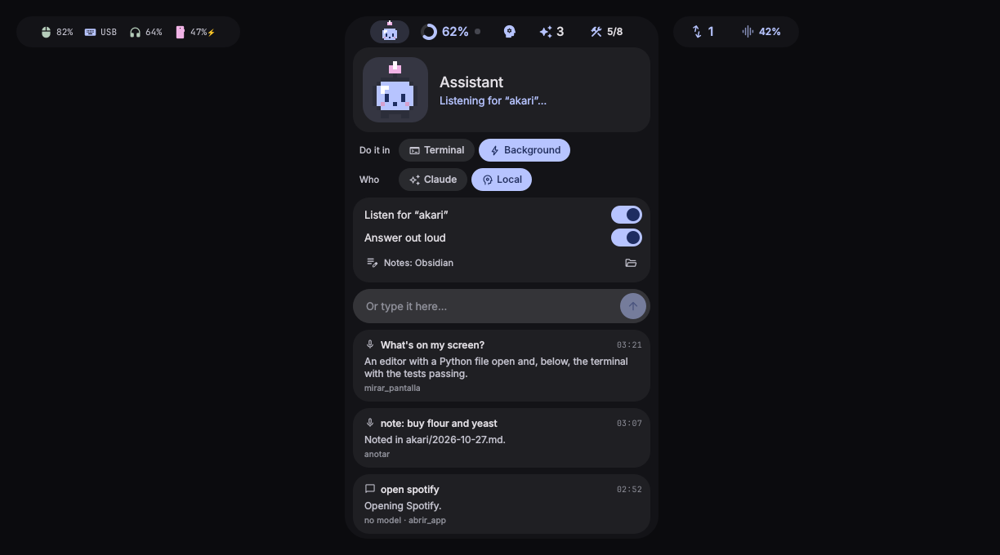
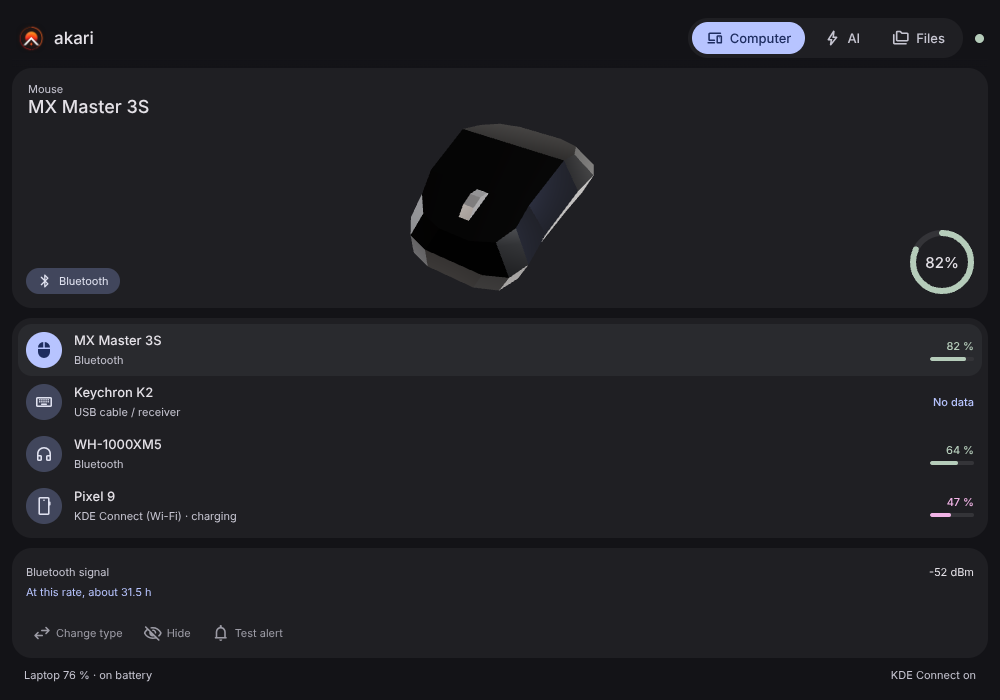
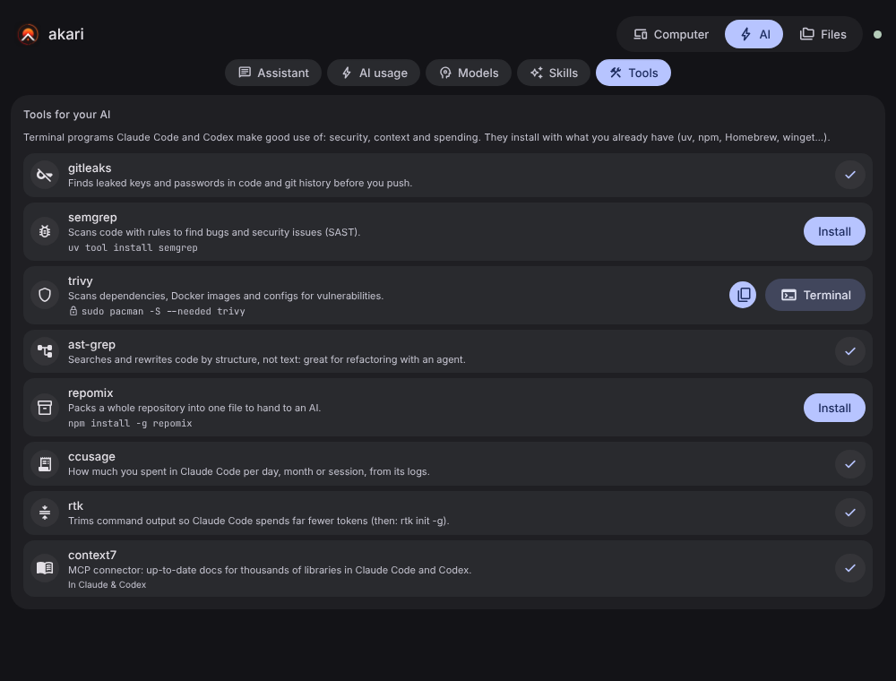
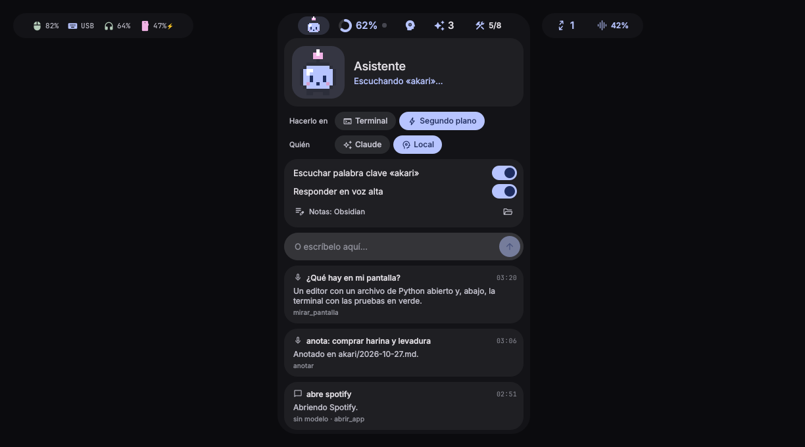
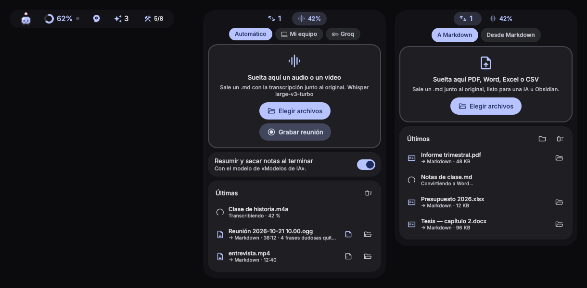

<p align="center">
  
</p>

<p align="center">
  <b>Floating desktop capsules for Linux and Windows: an AI assistant you can talk to, your AI usage and models, your devices, and documents & audio → Markdown — at a glance.</b><br>
  <a href="#español">Español</a> · <a href="#install">Install</a> · <a href="#first-steps">First steps</a> · <a href="#privacy">Privacy</a>
</p>

<p align="center">
  
</p>

**akari** (明かり, *light*) hangs three small capsules from the top edge of your screen — **Computer**, **AI**
and **Files**. Closed, each one is a pill with a small chip per feature; hover a chip and the capsule opens
right there, click another chip to switch. Drag it anywhere (or against a side edge to turn it into a vertical tab).

| Capsule | Feature | What it does |
|---|---|---|
| **Computer** | **Devices** | Your mouse, keyboard, headphones, phone, controllers… **detected automatically** (Bluetooth, USB, UPower, KDE Connect / GSConnect; on Windows, Bluetooth and USB through Plug and Play) with battery, charging state, codec/volume, Caps Lock, remaining time — and a **3D model** you can spin. Low-battery alerts. |
| **AI** | **Assistant** | Type to it — or say **“akari, …”** — and it does things on your computer: opens apps, links and folders, controls the music, reads your files (never keys or `.env`), **looks at your screen**, takes a photo with the camera only when you ask, searches the web, and takes notes in a Markdown folder (an Obsidian vault works). Answers with the model you chose (local or API) or with **Claude Code** in the background or in a terminal. Optional voice: wake word with Vosk confirmed by Whisper, spoken answers with Piper. |
| | **AI usage** | **Claude Code** and **Codex**: what's left of your 5-hour and weekly limits, when they renew, when you'd run out at the current pace, tokens today, the model in use, sessions. Alerts at 80 % / 95 %. A button (or a daily schedule) to **start your 5-hour window**. |
| | **AI models** | What the assistant and the summaries think with: an **API key** (Anthropic, OpenAI, Gemini, OpenRouter, Groq) or **free local models** with Ollama that akari recommends for *your* RAM and graphics card. |
| | **Skills** | The skills and MCP connectors your AI already has, how often it used each one, and **10 recommended everyday skills** you can install with one click for Claude Code and/or Codex. |
| | **Tools** | Terminal tools Claude Code and Codex make good use of — gitleaks, semgrep, trivy, ast-grep, repomix, ccusage, rtk and the context7 MCP — installed with what you already have (Homebrew, winget, uv, pipx, npm…); if only `sudo` would do, it shows the command or opens it in a terminal. |
| **Files** | **Documents** | PDF, Word and Excel → **Markdown** (for an AI or Obsidian), and Markdown or your clipboard → Word or PDF. Drop files on the capsule. |
| | **Audio** | Audio or video → **Markdown transcript** next to the original: locally with faster-whisper (large-v3-turbo on an NVIDIA card) or with your Groq/OpenAI key. Whisper's made-up lines (“thanks for watching”, loops…) are removed. Optional summary and notes. Record meetings (mic + what's playing) on Linux. |

Hide a feature or a whole capsule in `~/.config/akari/capsulas.json`: `{"ocultas": ["audio", "equipo"]}`.

## Works on every Linux desktop — and on Windows

| Desktop | Interface |
|---|---|
| KDE Plasma (Wayland), Hyprland (Caelestia, end-4…), Sway, niri, river, labwc, Wayfire, COSMIC | **Capsules** (Quickshell, layer-shell) |
| GNOME 45–50 (Ubuntu, Fedora…) | **Native GNOME Shell extension** in the top bar + full panel with 3D |
| X11, XFCE, Cinnamon, MATE, LXQt, Budgie, and distros without Quickshell (Debian, Ubuntu, Mint, Pop!_OS…) | **Bubbles app** (AppImage): the same three capsules (one bubble per group, `GET /api/burbujas` says which) — hover to open, drag, vertical tab on the side edges — plus a tray icon |
| **Windows 10 / 11** | **Bubbles app** (installer with Python built in) + tray icon, starts with Windows |

Every interface takes your desktop's colors: the full Caelestia scheme, the KDE or GNOME accent color,
pywal / wallust, or the Windows accent color (or your own, in `~/.config/akari/tema.json`).

**Distributions:** Arch and derivatives (CachyOS, EndeavourOS, Manjaro, Garuda — repos or AUR), Fedora,
openSUSE, Debian / Ubuntu / Mint, Void, Alpine, Solus, NixOS (Nix), Gentoo… with or without systemd
(OpenRC, runit, s6: Artix, Devuan, MX Linux…). Without systemd or PyGObject, akari talks to D-Bus by itself.

<p align="center">
  <br>
  <br>
  
</p>

## Install

```sh
curl -fsSL https://raw.githubusercontent.com/sJonathan15/akari/main/install.sh | bash
```

> **Ubuntu / GNOME:** after installing, **log out and log back in** — akari appears in the top bar.
> Then see [First steps](#first-steps) for your desktop.

**Windows 10 / 11** (PowerShell):

```powershell
irm https://raw.githubusercontent.com/sJonathan15/akari/main/install.ps1 | iex
```

or download `akari-setup-x64.exe` from [Releases](https://github.com/sJonathan15/akari/releases) and run it.
It installs for your user (no admin) and carries Python and the service inside: nothing else to install.
To remove it: *Settings → Apps → akari* (your settings in `%APPDATA%\akari` are kept).

> **SmartScreen:** the installer is not code-signed yet, so Windows may show *“Windows protected your PC”*.
> Click **More info → Run anyway**. (The installer is built by GitHub Actions from this repository.)

**Lightweight on Windows.** The Windows app (`escritorio/`, Tauri 2) uses WebView2, which ships with
Windows 10/11, instead of bundling Chromium. Closed groups are drawn natively (no browser at all): WebView2
only starts when you open one, and is freed a minute after you close it. Measured by CI on `windows-latest`
on every push (it fails if a target is missed):

| | Electron app (before) | Windows app (now) | Target |
|---|---|---|---|
| Installer | 122 MB | **15.7 MB** | ≤ 40 MB |
| RAM at rest (Working Set, all processes) | 319 MB | **51 MB** | ≤ 150 MB |
| CPU at rest | 0.11 % | **0.02 %** | ≈ 0 % |
| RAM 75 s after opening and closing a bubble | — | 59 MB | — |

The first time you open a bubble after starting, WebView2 takes a moment to start (5 s on the CI machine,
less on a normal PC); while it's alive, reopening is instant.

Linux, from a clone:

```sh
git clone https://github.com/sJonathan15/akari && cd akari && ./install.sh
```

The installer detects your distribution and desktop, installs what's missing (Quickshell where
available — from the repos, the AUR, the Fedora COPR or Nix — and the icon font), sets up `systemd --user`
services when there is systemd and, in any case, starts akari with your session (`~/.config/autostart`,
or `exec-once` / `exec` / `spawn-at-startup` in Hyprland, Sway, niri, labwc, river and Wayfire when they
are not started through systemd), and offers to connect Claude Code's status line (your current status
line is kept and still shown). Options: `--interfaz capsulas|gnome|app`, `--sin-statusline`,
`--sin-dependencias`, `--si`, `--desinstalar`.

**Just want the app?** Download `akari-*.AppImage` from [Releases](https://github.com/sJonathan15/akari/releases),
make it executable and run it: it carries its own service (only `python3` is needed, which every
distribution ships).

**Try it without your data:** `AKARI_DEMO=1 akari servicio` shows example data (assistant, models, documents and audio included).

### Requirements
- `python3` ≥ 3.9 (no pip packages). D-Bus is used through PyGObject if present, otherwise akari's own
  pure-Python client (or `busctl`). On Windows, nothing: the installer brings its own Python.
- Capsules: [Quickshell](https://quickshell.org) with Qt Quick 3D and `assimp` (installed for you on Arch and Fedora).
- Phone battery: KDE Connect (KDE) or GSConnect (GNOME) on the computer and the phone.

## First steps

After installing, **how you open akari depends on your desktop.** The installer prints this guide at
the end, and you can see it again any time with `akari guia`.

### Ubuntu / Fedora / any GNOME
1. **Log out and log back in** (first time only) — GNOME only loads extensions at login.
2. Three new icons appear at the **top right of the top bar**: your devices with their battery,
   ★ with what's left of Claude Code / Codex, and a flask with your skills. Click each one.
3. **Panel with 3D models:** *Open panel (with 3D)* in any of those menus, search **akari** in your
   apps, or run `akari abrir`.

Icons missing after logging back in? Run `gnome-extensions enable akari@sjonathan15.github.io` and log in again.

### KDE Plasma, Hyprland, Sway, niri…
Three capsules hang from the **top edge of the screen, near the center**. Hover to open, click the header
to pin, drag to move (against a side edge it becomes a vertical tab), double-click to send it home.
Not there? `systemctl --user restart akari akari-capsulas`.

### X11, XFCE, Cinnamon, MATE, Debian / Ubuntu without GNOME, others (and the AppImage)
The same **three bubbles at the top center**, with a tray icon: hover to open, click the header to pin,
drag to move (against a side edge it becomes a vertical tab), double-click to send it home. Click the tray
icon for the full panel; from its menu you can hide the bubbles, put them back in place or start them at
login. Closed it? Search **akari** in your apps or run `akari app`.

### Windows 10 / 11
The **three bubbles hang from the top of the screen** and the akari icon sits in the tray (next to the
clock; it may be under the **^** arrow). Same gestures as above. Tray menu: full panel, show/hide the
bubbles, start with Windows, connect to Claude Code. Phones show up when paired over Bluetooth or
plugged in over USB.

### Troubleshooting
| Problem | Fix |
|---|---|
| No data at all | `akari arrancar` · with systemd: `systemctl --user restart akari` · Windows: quit akari from the tray and open it again |
| `akari: command not found` | Log out and back in (adds `~/.local/bin` to your PATH) or use `~/.local/bin/akari` |
| Claude limits say "no reading yet" | Send any message in Claude Code — limits arrive with the next reply |
| Codex shows nothing | Use Codex once; akari reads `~/.codex/sessions` |
| Phone not shown | Install KDE Connect (KDE) or GSConnect (GNOME) on the computer **and** the phone, and pair them |
| AppImage won't open on Ubuntu | Re-run the installer (installs `libfuse2`); akari already adds `--no-sandbox` where AppArmor requires it |
| A device has the wrong type | Open it and use **Change type** or **Hide** |
| Bubbles with black corners (X11) | Your window manager has no compositor: turn on compositing (XFCE: *Window Manager Tweaks → Compositor*) |
| Hyprland / Sway: nothing after logging in | Run `akari arrancar`; if your `hyprland.conf` is a link to your dotfiles, add `exec-once = ~/.local/bin/akari arrancar` yourself |

## Using it

- **Hover** a chip on a capsule to open it there, **click** another chip to switch, **click** the open one to pin it,
  **drag** it to move it, **double-click** to send it back home. Drop it against the left/right edge to make it a vertical tab.
- **Drop a file** on the Files capsule: documents get converted, audio and video get transcribed.
- **Assistant:** type in “Or type it here…”, or turn on **Listen for “akari”** (after **Install voice**) and say
  *“akari, open Firefox”*, *“akari, what's on my screen?”*, *“akari, note: buy flour”*. “Open X”, music and the time
  are handled without spending tokens. With **Claude** + **Background** it runs `claude -p` with read-only tools;
  **Terminal** opens a terminal with `claude "<your text>"`.
- `akari estado` — summary in the terminal · `akari abrir` — full panel · `akari app` — bubbles · `akari arrancar` — start whatever is missing · `akari guia` — how to use it on your desktop.
- A device detected wrongly? Use **Change type** or **Hide** in its card.

### Settings (`~/.config/akari/`, on Windows `%APPDATA%\akari\`)
| File | What |
|---|---|
| `ajustes.json` | `{"idioma": "es"\|"en", "avisos": true, "interfaz": "capsulas"\|"gnome"\|"app"}` |
| `tema.json` | your own colors: `{"acento": "#ff8800"}` or Material 3 names (`primary`, `surface`…) |
| `dispositivos.json` | `ocultar`, `nombres`, `tipos`, `umbrales_bateria` (default `[20, 10, 5]`) |
| `posiciones.json` | where you left each capsule |
| `activar.json` | 5-hour window schedule |
| `capsulas.json` | `{"ocultas": [...]}`: features (`asistente`, `audio`…) or whole capsules (`equipo`, `ia`, `archivos`) to hide |
| `modelos.json` · `claves.json` | the AI model in use · your API keys (only readable by you, never shown back) |
| `asistente.json` | where/who, wake word, voice, notes folder |

Environment: `AKARI_PANTALLA=DP-1` (which monitor), `AKARI_SIN_MOVIMIENTO=1` (reduce motion).

<a id="privacy"></a>
## Privacy

Everything stays on your computer. The service listens only on `127.0.0.1:47830` and only accepts
JSON requests (so no website can trigger actions). akari **reads**:

- Claude Code: `~/.claude/projects/**/*.jsonl` (token counts), the status-line JSON (limits), and from
  `~/.claude.json` only your display name and plan.
- Codex: `~/.codex/sessions/**/rollout-*.jsonl` (token counts and limits), and from `~/.codex/auth.json`
  only the first name and plan inside the ID token. Tokens and e-mail addresses are never read out, stored or shown.
- Devices: BlueZ, UPower, `/sys`, PipeWire/PulseAudio, KDE Connect / GSConnect; on Windows, Plug and Play
  (Bluetooth and USB), the battery status and Caps Lock. Desktop colors: the files and settings listed above.

Network is used only to download skills you choose to install (from their original GitHub repository)
and, by the installer, fonts and the AppImage. The 5-hour window button runs `claude -p` with no tools.

The new features ask before using anything heavy and work offline when you choose local options:

- **AI models / assistant / audio:** with an API key, your question (and, when you ask it to look, the
  screenshot or photo) goes to that provider only; with Ollama, Whisper, Vosk and Piper everything stays on
  your computer. Optional packages go into akari's own Python environment, with a button and no password.
- **Screen and camera:** only when you ask; akari hides its capsules first, the image goes to the model and
  is **never saved**. The camera is refused unless your message mentions it.
- **Files:** the assistant only lists or reads inside your home folder and never `.ssh`, `.gnupg`, `.env`,
  keys, keyrings, tokens or credentials. It opens folders and documents, never executables. Notes are only
  written to `<your notes folder>/akari/YYYY-MM-DD.md`; your own notes are never edited.

## Recommended skills

| Skill | Source | License |
|---|---|---|
| PDF · Word · Excel · PowerPoint | [anthropics/skills](https://github.com/anthropics/skills) | Anthropic terms (use with your Claude account) |
| Doc co-authoring · Work updates & emails · Posters · Theme factory · Skill creator | [anthropics/skills](https://github.com/anthropics/skills) | Apache-2.0 |
| Diagrams (archify) | [tt-a1i/archify](https://github.com/tt-a1i/archify) | MIT |
| More: transcribe (Codex), frontend design, algorithmic art, web testing, MCP builder | anthropics/skills, [openai/skills](https://github.com/openai/skills) | Apache-2.0 |

Skills are downloaded on demand into `~/.claude/skills/` and/or `~/.codex/skills/`; akari only removes
the ones it installed. The list lives in [`akari/catalogo.json`](akari/catalogo.json) — PRs welcome.

## Development

```
akari/        Python service (stdlib only): ia.py (Claude Code + Codex), dispositivos.py, habilidades.py, servidor.py,
              windows.py (Windows devices), dbus_nativo.py (pure-Python D-Bus), tema.py (desktop colors),
              grupos.py (capsule groups), modelos.py, asistente.py + acciones.py + voz.py, documentos.py, audio.py,
              herramientas.py, extras.py (optional Python environments) · recursos/ (scripts run in those environments)
capsulas/     Quickshell capsules: CapsulaGrupo.qml + Pieza*.qml     web/       full panel + bubbles (three.js 3D)
app/          Electron app (bubbles, Linux X11 / GNOME) → AppImage       gnome/     GNOME Shell extension
escritorio/   Windows app (Rust, Tauri 2 + WebView2, native closed pills) → per-user NSIS installer
modelos/      CC0 3D models + herramientas/modelos.py
pruebas/      servicio/: service tests (Linux + Windows) · gnome/: headless GNOME Shell test (Docker)
```

- Run from the repo: `bin/akari servicio` and `AKARI_RAIZ=$PWD qs -p capsulas` (or `cd app && npm start` for the bubbles).
- Tests: `python3 -m unittest discover -s pruebas/servicio -p "prueba_*.py"` (CI runs them on Linux and Windows).
- AppImage: `cd app && npm install && npm run appimage`.
- Windows app (`escritorio/`, Rust + Tauri 2): `cd escritorio && powershell -File scripts/python.ps1 && npx @tauri-apps/cli@2.12.1 build --bundles nsis`
  (on Windows; `cargo test` runs anywhere). `scripts/medir.ps1` measures RAM/CPU like the CI does.
- Pushing a `v*` tag builds the AppImages (x86_64, arm64) and the Windows installer and publishes them in Releases.
- GNOME extension test: `docker build -t akari-gnome pruebas/gnome && pruebas/gnome/probar.sh`.

## Credits

3D models and studio light are **CC0** (public domain): mouse and headphones by CreativeTrio, phone by
Quaternius (via [Poly Pizza](https://poly.pizza)), studio HDRI by Sergej Majboroda ([Poly Haven](https://polyhaven.com));
the keyboard is generated by akari — see [modelos/CREDITS.md](modelos/CREDITS.md).
[three.js](https://threejs.org) (MIT), [Material Symbols](https://fonts.google.com/icons) (Apache-2.0), Rubik (OFL).
Code: [MIT](LICENSE).

---

<a id="español"></a>
## Español

**akari** (明かり, *luz*) cuelga tres cápsulas pequeñas del borde superior de tu pantalla: **Equipo**, **IA** y
**Archivos**. Cerrada, cada una es una píldora con un chip por función; pasa el ratón por un chip y se abre ahí
mismo, clic en otro chip para cambiar. Arrástralas a donde quieras (o contra un borde lateral para volverlas una
pestaña vertical).

- **Equipo · Dispositivos** — ratón, teclado, audífonos, celular, mandos… **detectados solos** (Bluetooth, USB,
  UPower, KDE Connect / GSConnect) con batería, carga, códec/volumen, Bloq Mayús, tiempo restante y un **modelo 3D**
  que puedes girar. Avisos de batería baja.
- **IA · Asistente** — escríbele o dile **«akari, …»** y hace cosas en tu equipo: abre apps, enlaces y carpetas,
  controla la música, lee tus archivos (nunca claves ni `.env`), **mira la pantalla**, saca una foto con la cámara
  solo si se lo pides, busca en la web y toma notas en una carpeta de Markdown (sirve tu bóveda de Obsidian).
  Responde con el modelo que elegiste (local o por API) o con **Claude Code** en segundo plano o en una terminal.
  Voz opcional: palabra clave con Vosk confirmada con Whisper y respuestas habladas con Piper. Es un muñequito
  pixel-art: un farolito con llama.
- **IA · Uso de IA** — **Claude Code** y **Codex**: cuánto te queda del límite de 5 horas y del semanal, cuándo se
  renuevan, a qué hora se acabaría a este ritmo, tokens de hoy, modelo en uso y sesiones. Avisos al 80 % y 95 %.
  Botón (o programación diaria) para **activar la ventana de 5 horas**.
- **IA · Modelos de IA** — con qué piensan el asistente y los resúmenes: una **clave de API** (Anthropic, OpenAI,
  Gemini, OpenRouter, Groq) o **modelos locales gratis** con Ollama, recomendados para *tu* RAM y tarjeta de video.
- **IA · Habilidades** — las skills y conectores MCP que ya tiene tu IA, cuántas veces usó cada una y **10
  habilidades recomendadas** que se instalan con un clic para Claude Code y/o Codex.
- **IA · Herramientas** — gitleaks, semgrep, trivy, ast-grep, repomix, ccusage, rtk y el MCP context7: si están, qué
  hacen y un botón para instalarlas con lo que ya tienes (Homebrew, winget, uv, pipx, npm…); si solo se puede con
  `sudo`, te muestra el comando o lo abre en una terminal.
- **Archivos · Documentos** — PDF, Word y Excel → **Markdown** (para una IA u Obsidian) y Markdown o lo copiado →
  Word o PDF. Suelta los archivos sobre la cápsula.
- **Archivos · Audio** — audio o video → **transcripción en Markdown** junto al original: en tu equipo con
  faster-whisper (large-v3-turbo en una NVIDIA) o con tu clave de Groq/OpenAI. Quita lo que Whisper inventa
  («gracias por ver», bucles…). Resumen y notas opcionales. Grabar reuniones (micrófono + lo que suena) en Linux.

<p align="center"><br>
</p>

Para ocultar una función o una cápsula entera: `~/.config/akari/capsulas.json` con `{"ocultas": ["audio", "equipo"]}`.

**Funciona en todo Linux y en Windows:** cápsulas en KDE Plasma, Hyprland (Caelestia…), Sway, niri y demás
compositores con layer-shell; **extensión nativa** en GNOME 45–50; y **burbujas** —las mismas tres cápsulas, con
icono en la bandeja— en X11, XFCE, Cinnamon, MATE, LXQt, Budgie, en las distribuciones sin Quickshell (Debian,
Ubuntu, Mint, Pop!_OS…) y en **Windows 10 / 11**. Toma los colores de tu escritorio: el esquema de Caelestia, el
acento de KDE o de GNOME, pywal / wallust o el color de énfasis de Windows.

**Distribuciones:** Arch y derivadas (CachyOS, EndeavourOS, Manjaro, Garuda: repositorios o AUR), Fedora, openSUSE,
Debian / Ubuntu / Mint, Void, Alpine, Solus, NixOS (Nix), Gentoo… con o sin systemd (OpenRC, runit, s6: Artix,
Devuan, MX Linux…). Sin systemd ni PyGObject, akari habla con D-Bus por su cuenta.

### Instalar

```sh
curl -fsSL https://raw.githubusercontent.com/sJonathan15/akari/main/install.sh | bash
```

> **Ubuntu / GNOME:** al terminar, **cierra sesión y vuelve a entrar**: akari aparece en la barra superior.
> Luego mira [Primeros pasos](#primeros-pasos) para tu escritorio.

**Windows 10 / 11** (PowerShell):

```powershell
irm https://raw.githubusercontent.com/sJonathan15/akari/main/install.ps1 | iex
```

o baja `akari-setup-x64.exe` de [Releases](https://github.com/sJonathan15/akari/releases) y ejecútalo: se instala para
tu usuario (sin admin) y trae dentro Python y el servicio, no hay que instalar nada más. Para quitarlo:
*Configuración → Aplicaciones → akari* (tus ajustes de `%APPDATA%\akari` se quedan).

> **SmartScreen:** el instalador todavía no está firmado, así que Windows puede decir *«Windows protegió su PC»*.
> Haz clic en **Más información → Ejecutar de todas formas**. (Lo compila GitHub Actions desde este repositorio.)

**Liviano en Windows.** La app de Windows (`escritorio/`, Tauri 2) usa WebView2, que ya viene en Windows 10/11, en
lugar de traer su propio Chromium. Los grupos cerrados se dibujan de forma nativa (sin navegador): WebView2 solo
arranca al abrir uno y se libera un minuto después de cerrarlo. Medido por el CI en `windows-latest` en cada push
(falla si no se cumple una meta):

| | App Electron (antes) | App de Windows (ahora) | Meta |
|---|---|---|---|
| Instalador | 122 MB | **15,7 MB** | ≤ 40 MB |
| RAM en reposo (Working Set, todos los procesos) | 319 MB | **51 MB** | ≤ 150 MB |
| CPU en reposo | 0,11 % | **0,02 %** | ≈ 0 % |
| RAM 75 s después de abrir y cerrar una burbuja | — | 59 MB | — |

La primera vez que abres una burbuja tras arrancar, WebView2 tarda un momento en iniciar (5 s en la máquina del
CI, menos en un PC normal); mientras sigue vivo, reabrir es instantáneo.

El instalador de Linux detecta tu distribución y tu escritorio, instala lo que falta (Quickshell desde los
repositorios, el AUR, el COPR de Fedora o Nix), deja los servicios de `systemd --user` si hay systemd y, en todo
caso, hace que akari arranque con tu sesión (`~/.config/autostart`, o `exec-once` / `exec` / `spawn-at-startup` en
Hyprland, Sway, niri, labwc, river y Wayfire cuando no arrancan con systemd), y te ofrece conectar la línea de estado
de Claude Code (la tuya se conserva). Opciones: `--interfaz capsulas|gnome|app`. Para quitarlo:
`./install.sh --desinstalar`. ¿Solo la app? Baja el AppImage de [Releases](https://github.com/sJonathan15/akari/releases).
¿Probar sin tus datos? `AKARI_DEMO=1 akari servicio` (con datos de ejemplo del asistente, modelos, documentos y audio).

<a id="primeros-pasos"></a>
### Primeros pasos

Después de instalar, **cómo se abre akari depende de tu escritorio**. El instalador muestra esta guía al
terminar y puedes verla cuando quieras con `akari guia`.

**Ubuntu / Fedora / cualquier GNOME**
1. **Cierra sesión y vuelve a entrar** (solo la primera vez): GNOME carga las extensiones al iniciar sesión.
2. Aparecen tres iconos **arriba a la derecha de la barra superior**: tus dispositivos con su batería,
   ★ con lo que te queda de Claude Code / Codex, y un matraz con tus habilidades. Haz clic en cada uno.
3. **Panel con modelos 3D:** *Abrir panel (con 3D)* en cualquiera de esos menús, busca **akari** en tus
   aplicaciones o ejecuta `akari abrir`.

¿No aparecen tras volver a entrar? `gnome-extensions enable akari@sjonathan15.github.io` y vuelve a entrar.

**KDE Plasma, Hyprland, Sway, niri…** — tres cápsulas cuelgan del **borde superior, cerca del centro**. Pasa
el ratón para abrirlas, clic en la cabecera para fijarlas, arrástralas para moverlas, doble clic para devolverlas.
¿No están? `systemctl --user restart akari akari-capsulas`.

**X11, XFCE, Cinnamon, MATE, Debian / Ubuntu sin GNOME, otros (y el AppImage)** — las mismas **tres burbujas
arriba al centro**, con icono en la bandeja: pasa el ratón para abrirlas, clic en la cabecera para fijarlas,
arrástralas (contra un borde lateral se vuelven pestaña vertical), doble clic para devolverlas. Clic en el icono de
la bandeja abre el panel completo; desde su menú las ocultas, las devuelves a su sitio o eliges si arrancan con la
sesión. ¿Las cerraste? Busca **akari** en tus aplicaciones o ejecuta `akari app`.

**Windows 10 / 11** — las **tres burbujas cuelgan del borde de arriba** y el icono de akari queda en la bandeja
(junto al reloj; puede estar bajo la flecha **^**). Se usan igual. Desde el menú de la bandeja: panel completo,
mostrar u ocultar las burbujas, iniciar con Windows y conectar con Claude Code. El celular aparece si está
vinculado por Bluetooth o conectado por USB.

| Problema | Solución |
|---|---|
| No sale ningún dato | `akari arrancar` · con systemd: `systemctl --user restart akari` · Windows: sal de akari desde la bandeja y vuelve a abrirlo |
| `akari: orden no encontrada` | Cierra sesión y vuelve a entrar (agrega `~/.local/bin` al PATH) o usa `~/.local/bin/akari` |
| Los límites de Claude dicen "sin lectura" | Envía un mensaje en Claude Code: llegan con la siguiente respuesta |
| Codex no muestra nada | Usa Codex una vez; akari lee `~/.codex/sessions` |
| No aparece el celular | Instala KDE Connect (KDE) o GSConnect (GNOME) en el equipo **y** en el celular, y vincúlalos |
| El AppImage no abre en Ubuntu | Vuelve a ejecutar el instalador (instala `libfuse2`); akari ya agrega `--no-sandbox` donde AppArmor lo exige |
| Un dispositivo salió con otro tipo | Ábrelo y usa **Cambiar tipo** u **Ocultar** |
| Burbujas con esquinas negras (X11) | Tu gestor de ventanas no tiene compositor: actívalo (XFCE: *Retoques del gestor de ventanas → Compositor*) |
| Hyprland / Sway: no aparece nada al entrar | Ejecuta `akari arrancar`; si tu `hyprland.conf` es un enlace a tus dotfiles, agrega tú `exec-once = ~/.local/bin/akari arrancar` |

### Privacidad
Todo se queda en tu equipo: el servicio solo escucha en `127.0.0.1` y solo acepta JSON. De tus cuentas lee
únicamente el nombre y el plan; nunca tokens ni correos. La red solo se usa para bajar las habilidades que elijas
instalar (desde su repositorio original) y, al instalar, las fuentes y el AppImage.

Con una clave de API, tu pregunta (y la captura o la foto, si le pides mirar) va solo a ese proveedor; con Ollama,
Whisper, Vosk y Piper nada sale del equipo. La pantalla y la cámara solo a pedido: akari esconde sus cápsulas antes,
la imagen va al modelo y **nunca se guarda**. El asistente solo lee dentro de tu carpeta personal y nunca `.ssh`,
`.env`, claves, llaveros ni credenciales; abre carpetas y documentos, nunca programas; y anota solo en
`<tu carpeta de notas>/akari/AAAA-MM-DD.md`, sin tocar tus notas.

### Uso
Pasa el ratón por un chip para abrir la cápsula ahí, clic en otro chip para cambiar, clic en el abierto para dejarla
fija, arrastra para mover, doble clic para devolverla a su sitio. Suelta archivos sobre **Archivos** para convertirlos
o transcribirlos. Al asistente escríbele en «O escríbelo aquí…» o, tras **Instalar voz**, activa **Escuchar palabra
clave** y di *«akari, abre Firefox»*, *«akari, ¿qué hay en mi pantalla?»*, *«akari, anota: comprar harina»*. «Abre X»,
la música y la hora se resuelven sin gastar tokens. En la terminal: `akari estado` (resumen) y `akari abrir` (panel completo). ¿Un dispositivo salió con el
tipo equivocado? Usa **Cambiar tipo** u **Ocultar** en su tarjeta. Ajustes en `~/.config/akari/` (ver la tabla de arriba).

Modelos 3D **CC0** (dominio público) · código **MIT**.
